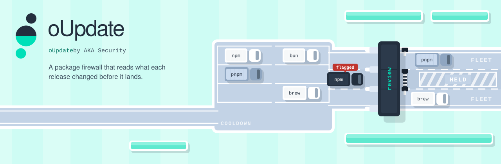

<picture>
  <source media="(prefers-color-scheme: dark)" srcset="assets/cover-dark.svg">
  
</picture>

<p align="center">
  <a href="#install"><b>Install</b></a> &nbsp;·&nbsp;
  <a href="#configuration"><b>Configuration</b></a> &nbsp;·&nbsp;
  <a href="#gate-update-prs-on-a-forge"><b>Gate update PRs</b></a> &nbsp;·&nbsp;
  <a href="#host-apply"><b>Host apply</b></a> &nbsp;·&nbsp;
  <a href="#license"><b>License</b></a>
</p>

<h3 align="center">An open-source package firewall that reads what each new release changed before it lands.</h3>

oUpdate is an open-source package firewall. Before a new release of a package lands, it reads what the release changed. Deterministic checks look for known attack patterns, such as install scripts, Python startup hooks and encoded payloads. A model you choose, either a local model you run or a cloud model, reviews the release diff itself. Nothing waits on an advisory or a threat feed, so a release nobody has reported yet still gets read.

In [an evaluation](docs/evaluation-2026-10-26.md) on 9 real supply-chain attacks and 8 clean releases, with no threat feeds or advisories, it stopped all 9 attacks and held none of the 8 clean releases. The attacks include Shai-Hulud in @ctrl/tinycolor 4.1.1, s1ngularity in @nx/devkit 21.5.0, and litellm 1.107.0.

- **On a Mac**, it takes Homebrew and npm updates as soon as they clear their checks, with no waiting period. A model reviews npm global packages and formulae from third-party Homebrew taps. Formulae from Homebrew's own taps get a deterministic version policy. An upgraded cask's files are cleared to run only when they pass Apple's signing and notarization checks.
- **In your repos**, dependency updates from your update bot get a 2-day cooldown and the same review, then a commit status that your own gate acts on before they land.

## What it covers

| Where | What oUpdate reviews | Command |
|---|---|---|
| One release, on demand | an npm or PyPI package update | `oupdate review` |
| One container image, before you repin it | the old and new image's Entrypoint, Cmd and build history, from any registry that allows anonymous pulls | `oupdate image`, see [Check one image](#check-one-image) |
| Update PRs in your repos | npm packages in `bun.lock`, `package-lock.json`, `npm-shrinkwrap.json` and `pnpm-lock.yaml`; PyPI packages in `uv.lock`, `poetry.lock` and pinned requirements files; on GitHub, Gitea and API-compatible forges | `oupdate gate` |
| A Mac | Homebrew formulae and casks, global npm packages | `oupdate host --apply` |
| Images, a NAS, VMs | Docker Compose images, NAS plugins and OS, OS packages on Google Cloud VMs, only through a credential broker | `oupdate targets`, see [OS targets](#os-targets) |

Not covered yet: `yarn.lock` in the gate; apt or other OS packages on a host you reach directly; the Mac App Store. oUpdate is not a hook on your package manager: an install that someone runs by hand, or that an agent runs, never reaches it.

**Reading a verdict.** Treat a FLAG or a hold as a stop until a person has looked. Treat an APPROVE as one piece of evidence, not clearance: the model reads the release diff and can be wrong, and a release too large for the review budget is held for a person rather than judged.

Early release, built from tools that run in production; the interfaces may still change. The easiest way to install it is to ask your coding agent to set it up; see [Set up with your agent](#set-up-with-your-agent).

## Install

oUpdate is a Bun and TypeScript tool. It needs [Bun](https://bun.sh); there is no build step.

Install a release tag, not the tip of `main`, and check that the commit matches the one on the [release page](https://github.com/akasecurity/oupdate/releases):

```
git clone --branch v0.2.1 https://github.com/akasecurity/oupdate.git
cd oupdate
git rev-parse HEAD
bun install
bun src/cli.ts review npm ms 2.1.2 2.1.3
```

`bin` in `package.json` maps `oupdate` to `src/cli.ts`, so `bun link` gives you an `oupdate` command.

### Before you run it

oUpdate becomes part of your supply chain, so read it before you trust it:
- It has no runtime dependencies. `bun.lock` holds only the dev tools (TypeScript and Bun's types).
- `review` and `gate` download release archives from the registry and read them; they never install a package or run its code (archives are read with `bsdtar`; the optional GuardDog layer runs in the container you give it). The network calls go to the package registries, OSV, your reviewer endpoint and, for `gate`, your forge.
- `image` reads two images' manifests and config blobs from their container registry; it never pulls a layer or runs the image.
- Nothing runs as root unless you schedule `host --apply` as a LaunchDaemon yourself. Start with `host --apply --dry-run`: it runs every check and changes nothing on disk.

### Set up with your agent

Paste this into your coding agent:

```
Set up oUpdate (https://github.com/akasecurity/oupdate) on this machine for me. Clone it, read its AGENTS.md and follow it step by step. Ask me before anything that changes my system.
```

[AGENTS.md](AGENTS.md) gives the agent the order to work in:
- what you want oUpdate for;
- prerequisites, then the install;
- a local or hosted reviewer model, checked on a known-clean update;
- a dry run before any live run;
- scheduling only with your approval.

## Configuration

Most commands take their settings as flags (`--reviewer`, `--scanner`, `--token-file`). The host commands read a JSON config from `$HOME/.config/oupdate/config.json` or the file you pass with `--config`; the `apply` object is described under [Host apply](#host-apply). `${NAME}` in any config value is read from the environment. `scripts/sample.config.example.json` is a minimal config with one local OpenAI-compatible reviewer and placeholders only.

## Gate update PRs on a forge

Run after your update bot (Renovate or Dependabot): for each open PR on a `renovate/` branch, oUpdate diffs the lockfiles between base and head and reviews every package version the PR brings in. It then posts a commit status `oupdate/review` and one comment carrying the per-layer verdicts.

- **Branches:** `--branch-prefix` (repeatable) replaces the `renovate/` default, for example `--branch-prefix dependabot/ --branch-prefix renovate/`.
- **Forge:** `--forge gitea` (the default) needs `--endpoint`. `--forge github` talks to `https://api.github.com`, or to `$GITHUB_API_URL` or `--endpoint` on GitHub Enterprise Server; see [On GitHub](#on-github).
- **Token:** `--token-file FILE`, or `--token-env NAME` to read it from an environment variable.
- **Lockfiles:** for npm, `bun.lock`, `package-lock.json` and `npm-shrinkwrap.json` (lockfileVersion 2 and 3), and `pnpm-lock.yaml` (v5, v6 and v9); for PyPI, `uv.lock` and `poetry.lock`. Without `--lock`, the gate reads each of these names that the PR's head has at the repo root. `--lock PATH` (repeatable) names them instead, for a lockfile in a subdirectory, say. All lockfiles go into one status; a version bumped in two of them is reviewed once.
- **Requirements files:** a pinned `requirements*.txt` or `*.lock.txt` (pip-compile output, for example) is read only when `--lock` names it, since the name alone does not say a file is pinned. Only exact `name==version` lines count; ranges, `-r` includes, editables and `name @ url` lines are skipped. Python package names are compared in their PEP 503 form, so `Typing_Extensions` and `typing-extensions` are one package.
- **Skipped entries:** workspace packages, links, editable and path installs, and git, file and url dependencies have no registry version to review.
- **Integrity:** when the lockfile records a sha512 integrity, the download is checked against it, so the review reads the exact bytes the install fetches. A mismatch holds the package. Python lockfiles record sha256 hashes, which are not checked yet: a PyPI download is reviewed without that check.
- **Private registry:** a version from a registry other than the public npm registry, or an index other than PyPI (a uv `registry` source, a poetry `legacy` source, or a requirements file's `--index-url`), is listed in the comment as "not reviewed (private registry)" and does not change the status.
- **A lockfile that cannot be read** (an npm 6 `package-lock.json`, lockfileVersion 1, or a file that does not parse) holds the PR at pending with the reason, never success.

```
oupdate gate --endpoint https://forge.example/api/v1 --repo owner/name \
  --token-file ~/.config/oupdate/forge-token \
  --reviewer '{"type":"openai","name":"local","baseUrls":["http://127.0.0.1:8080/v1"],"model":"your-model"}'
```

- **success:** every change lands.
- **failure:** a layer other than cooldown stopped one.
- **pending:** only cooldown or layer errors held it; the next run reviews it again.

The advisory layer splits OSV entries in two:
- **Malicious** (an OpenSSF `MAL-` id or alias) always stops the update. The comment opens with a MALICIOUS line, because the useful next step is checking where that version is already installed.
- **Vulnerabilities** stop only the ones this update introduces. If the old version already had one, keeping the old version would not help, so it is listed as "already in" and does not stop the update. Vulnerabilities the update removes are listed as "fixes".

Heads that already have success or failure are skipped. GitHub, Gitea and API-compatible forges (Forgejo) are supported.

### On GitHub

The gate reports with a commit status, not a check run, so it works with the Actions `GITHUB_TOKEN` and with a personal access token alike, and branch protection can require `oupdate/review` like any other check. Lockfiles are read raw, so a `package-lock.json` over 1 MB is read in full.

Run it on a schedule from the repo it gates, with `.github/workflows/oupdate-gate.yml`:

```yaml
name: oupdate gate
on:
  schedule: [{ cron: "17 * * * *" }]
  workflow_dispatch: {}
permissions:
  contents: read
  statuses: write
  pull-requests: write
jobs:
  gate:
    runs-on: ubuntu-latest
    steps:
      - uses: oven-sh/setup-bun@<commit-sha>    # pin actions to a full commit sha
      - uses: actions/checkout@<commit-sha>
        with: { repository: akasecurity/oupdate, ref: v0.2.1, path: .oupdate }
      - run: >
          bun .oupdate/src/cli.ts gate --forge github --repo "$GITHUB_REPOSITORY"
          --token-env GITHUB_TOKEN --branch-prefix dependabot/ --branch-prefix renovate/
          --reviewer "$OUPDATE_REVIEWER"
        env:
          GITHUB_TOKEN: ${{ secrets.GITHUB_TOKEN }}
          OUPDATE_REVIEWER: ${{ vars.OUPDATE_REVIEWER }}
          REVIEWER_API_KEY: ${{ secrets.REVIEWER_API_KEY }}
```

`OUPDATE_REVIEWER` is a repository variable holding the reviewer spec, for example `{"type":"openai","name":"cloud","baseUrls":["https://api.example/v1"],"model":"your-model","apiKeyEnv":"REVIEWER_API_KEY"}`; `apiKeyEnv` names the secret the step passes in. A hosted runner cannot reach a model on your own machine; for a local model, use a self-hosted runner.

Why a schedule and not `pull_request`:
- A run that a Dependabot PR triggers gets a read-only token and no secrets, so it could not post the status or call the reviewer.
- The gate never checks out the PR's code; it reads the lockfiles through the API. A scheduled run on the default branch is safe.
- Cooldown holds need runs after the PR opened anyway: a pending PR is reviewed again on each run.

## Check one image

Before you repin a container image, compare the new image with the one you run now:

```
oupdate image registry.example/team/app-a:5.14.0 registry.example/team/app-a@sha256:<64 hex> \
  --reviewer '{"type":"openai","name":"local","baseUrls":["http://127.0.0.1:8080/v1"],"model":"your-model"}'
```

Both refs must name the same repository; each is a tag or a `@sha256:` digest, and a bare name means Docker Hub. oUpdate reads both images from the registry for one platform (`--platform`, default `linux/amd64`) without pulling them, and checks every manifest and config against its digest. The evidence is the same as for Docker Compose images on a NAS: the Entrypoint and Cmd, and the build history lines the new image adds. It reads no layer contents and no advisories. A pre-gate holds an Entrypoint or Cmd change, a fetch piped to a shell, SSH keys and similar lines whatever the model says; then the reviewer reads the diff. With `--second-reviewer`, both must approve.

- **Exit 0 (LAND):** the two refs are the same image, or the pre-gate is clean and the reviewers approve.
- **Exit 1 (HOLD):** a pre-gate hit, a FLAG, no reviewer, a reviewer that failed, or an image that could not be read (BASELINE MISSING).
- **Exit 2:** a usage error.

`--json FILE` writes the result, including the platform manifest digests. Private registries are not supported yet: the registry must allow anonymous pulls.

## GuardDog layer

<details>
<summary><b>The static rule scanner</b> that runs between the pre-pass and the reviewer</summary>

Between the pre-pass and the reviewer, a static rule scanner can run on both releases: `--scanner JSON` on `review` and `gate`. It sees only the files the new release adds or changes, plus the old copies of the changed files. Only rule + path pairs that are new in the new release count.

Why changed files only: GuardDog 3.2.0 stops each rule after its `max_hits` (1 to 3) matches per package, in sorted walk order. Unchanged code that sorts first can use up a rule's budget and hide a new file: litellm 1.107.0's payload under `litellm-1.107.0.data/purelib/` raised nothing beside the 3,773-file `litellm/` directory. The budget still applies inside the changed set, so a large release can still hide a match behind another changed file. They reach the reviewer as soft signals and mark their files as priority files. With no scanner the layer is skipped; a scanner that fails, times out or reports a rule error holds the update.

oUpdate writes the files it already unpacked into a fresh directory (dirs 0755, files 0644, every path checked) and passes the directory, not the archive, so GuardDog's own extraction never runs on untrusted input. The command is an argv with `{eco}` and `{dir}` placeholders, run with no shell. Run it in the sandbox image from `sandbox/guarddog/` (hash-locked wheels, non-root user):

```
oupdate review npm some-pkg 1.0.0 1.0.1 --scanner '{"type":"guarddog","name":"guarddog",
  "workRoot":"<dir under $HOME>","stripPrefix":"/scan","timeoutMs":600000,
  "argv":["docker","run","--rm","--network","none","--read-only","--tmpfs","/tmp:rw,size=256m",
    "--cap-drop","ALL","--security-opt","no-new-privileges","--memory","2g","--pids-limit","256",
    "-v","{dir}:/scan:ro","oupdate-guarddog:local","{eco}","scan","/scan","--output-format","json"]}'
```

- `--network none`: GuardDog tries to refresh its popular-package lists and logs a network error. The rules still run.
- `workRoot` goes under `$HOME`, because a colima or Docker Desktop VM mounts only the home directory.
- Build the image with `docker build -t oupdate-guarddog:local sandbox/guarddog`. To refresh the lock, run `sandbox/guarddog/lock.sh`; it only takes wheels at least 7 days old.


### Review budget

The local reviewer reads the release diff in parts, at most 12. When the whole diff is over that, it reads the priority files only: files with a pre-pass or scanner signal, new files, manifests and install or startup files. When those are still over it, it reads the signal files only: files with a signal, manifests and install or startup files. When even the signal files are over 12 parts, it ranks the priority files and reads the top 12 parts: files with a hard pre-pass signal first, then scanner hits, install or startup files, manifests, new files, and changed files with a soft signal. A FLAG on the signal files stops the update. An APPROVE there does not land it, because the rest of the diff was not read: the update stays held for a human, and the verdict names how many parts and files were left out.

</details>

## Client keys

<details>
<summary><b>Client keys</b>: the settings oUpdate checks on each package manager</summary>

`oupdate keys [DIR] [--cooldown-days N] [--json]` checks the install-time hardening the package managers already ship, in a repo's own config. It finds the managers from their lockfiles and only reads; it never edits a file. Exit 1 when a key is missing or too weak.

| manager | file | key | want |
|---|---|---|---|
| npm | `.npmrc` | `ignore-scripts` | `true` |
| npm | `.npmrc` | `allow-git` | `none` |
| npm | `.npmrc` | `min-release-age` | at least the cooldown, in days |
| pnpm | `pnpm-workspace.yaml` (or `.npmrc` kebab-case) | `strictDepBuilds` | `true` |
| pnpm | same | `minimumReleaseAge` | at least the cooldown, in minutes |
| bun | `bunfig.toml` `[install]` | `minimumReleaseAge` | at least the cooldown, in seconds |
| uv | `uv.toml` or `pyproject.toml` `[tool.uv]` | `exclude-newer` | a rolling duration (`"2 days"`, `P2D`); a fixed date is weak |

The build-script allow-lists are listed, not judged: pnpm `allowBuilds` (or the older `onlyBuiltDependencies`) and bun `trustedDependencies` (bun runs no other dependency's lifecycle scripts). Build-script denial stops the install-script attacks; it does not stop a payload that runs at import or at Python start, which is what the review layers are for. None of these keys lifts the cooldown for an advisory fix: `oupdate review --advisory-fix` does that.

</details>

## Host shadow report

<details>
<summary><b>The read-only host report</b></summary>

`oupdate host --report-only --state DIR [--host NAME] [--prev-log PATH]` reads the installed inventory of this host (Homebrew formulae and casks, global npm packages, Docker images, macOS and its pending updates, agent CLI versions). It runs read-only commands only, with `HOMEBREW_NO_AUTO_UPDATE=1`, and never updates or installs anything. Advisories for the npm globals come from OSV; a failed lookup is a note in the report, never "no advisories".

It compares the run against the last summary block of the previous updater's run log (its log: `--prev-log`):
- what changed since the previous snapshot, against the previous updater's `upgraded:` and `casks upgraded:` names (a brew `node` upgrade covers a changed `npm` global, since the node bottle ships its own npm);
- what is still outdated, against what the previous updater held: flagged (a Type B FLAG in the run body counts too), stuck, failed, skipped by CASK_EXCLUDE, or listed in a repo's `pins.json` (the previous updater's `PINNED:` part). A brew-pinned package counts as held. An npm batch the previous updater FLAGGED (its summary names no packages) holds every outdated npm global.

It writes `DIR/inventory.json` (the snapshot for the next run) and `DIR/reports/<date>.json`, then prints a summary with the number of weeks in a row in which every report agreed. Run it once the previous updater finishes, so a release published later that day doesn't show up as a disagreement.

</details>

## Host apply

`oupdate host --apply` applies this host's Homebrew formula, cask and npm global updates, with the guards of the updater it replaces. Run `--dry-run` first: it runs every check and changes nothing on disk. It skips `brew update` and the HEAD fetch, upgrades, restarts, cleanup, the waiter and state writes, and it logs notices without sending them.

### Quick start

1. Write the `apply` object in `$HOME/.config/oupdate/config.json` (or pass `--config FILE`). Paths must be absolute; an unknown key is an error. `{date}` in `logFile` is the run's local date as YYYYMMDD, so each day gets its own file. Give `brew` and `npm` as absolute paths when launchd runs it: a LaunchDaemon's PATH has no Homebrew directory. `claudeCode` is the absolute path of the native Claude Code binary (the install's `.local/bin/claude` in the user's home); leave it out on a host without one. `notify` is a command that gets each notice as its last argument; `[]` means log-only by choice (see below). `postUpgradeCheck` (optional, off by default) maps a package name to an argv, e.g. `{"git": ["git", "--version"]}`: after the run, each package upgraded in it (brew or npm; a tap-qualified brew name matches on its last segment) gets its command run once, and a non-zero exit or a timeout is logged (`post-upgrade check: <name> FAILED (rc=N)`), notified, counted as `FAILED: check:<name>` in the brew line (so the run exits 1) and never aborts the run. A dry run runs no check.

   ```json
   {
     "apply": {
       "stateDir": "/var/lib/oupdate",
       "logFile": "/var/log/oupdate/{date}.log",
       "brew": "/opt/homebrew/bin/brew",
       "npm": "/opt/homebrew/bin/npm",
       "claudeCode": "/opt/example/bin/claude",
       "typeBTaps": ["example/tool"],
       "upstreamTaps": ["example/tool"],
       "approvedTapsFile": "/etc/oupdate/approved-taps.tsv",
       "pinRoots": ["/srv/repos"],
       "caskExclude": ["some-huge-suite"],
       "reviewer": { "type": "openai", "name": "local", "baseUrls": ["http://127.0.0.1:8080/v1"], "model": "your-model" },
       "notify": ["/usr/local/bin/your-notice-command"],
       "labelRestart": { "org.example.quiet-daemon": ["/usr/local/sbin/restart-when-quiet", "--wait"], "org.example.manual": "skip" }
     }
   }
   ```

2. `oupdate host --apply --dry-run` prints the run and a dry-run summary. Read the tier split, the holds and the notices it would have sent. It writes `dry-run-<log file name>` beside the log, never the dated log itself, and its header and summary are named so that nothing reading a log takes a dry run for a run.
3. `oupdate host --apply` is the live run. The exit code is 1 when anything failed.
4. Schedule it with launchd or cron. See [Schedule it](#schedule-it).

Every line goes to the log file and stdout as it is made. A run stopped by SIGTERM or SIGINT (or SIGHUP, when started from a terminal), or one that crashes, ends with an `=== ABORTED: ...` line: the commands it was running are stopped (SIGTERM, then SIGKILL), nothing new starts (no command, no reviewer command, no idle waiter, no delayed restart), nothing more is logged, no done notice is sent, and the exit code is the signal's (143, 130, 129). A dry run or a Gatekeeper one-off stopped that way ends with `=== STOPPED: ...` instead, in its own log file. Without a terminal (launchd, `nohup`), SIGHUP is left alone, so `nohup` keeps a logout from stopping the run. A finished run ends with the summary block the host shadow report already reads, then a done notice:

```
=== <host> summary ===
  brew: upgraded: ...; casks upgraded: ...; PINNED: ...; STUCK: ...
  npm:  upgraded: ...; claude-code: 2.1.309
  mas:  not checked — the App Store phase is not in oupdate
```

`mas` reads "not checked" on every run by design: the App Store phase is not in oUpdate, and the words are not ones the digest counts as trouble. `claude-code` is the version after the update, `FAILED (rc=<rc>, on <version>)` or `FAILED (timeout, on <version>)` when the update failed (`unknown` when `--version` fails too), `not configured` without `claudeCode`, and `dry-run` in a dry run. A `claudeCode` path that is not executable is skipped with no `claude-code` part, as the previous updater did.

### Schedule it

`oupdate host --launchd-plist` prints a LaunchDaemon plist that runs `oupdate host --apply` every day at one time. It writes nothing; you install it as root.

```
oupdate host --launchd-plist --label org.example.oupdate-apply --user USER --at 03:30 \
  [--config FILE] [--bun PATH] [--app DIR] [--home DIR] [--stdout FILE] [--path DIR]... > org.example.oupdate-apply.plist
```

- The label takes letters, digits, `.` and `-` only; it becomes the plist's file name.
- The job runs as `--user` with group `staff`, at `--at` (HH:MM, 00:00 to 23:59), and not at load. It has no KeepAlive and no AbandonProcessGroup: the idle waiter detaches itself.
- It runs `<bun> <app>/src/cli.ts host --apply`, plus `--config FILE` when given. `--bun` defaults to the `bun` found on PATH, as found (not resolved), and `--app` to this tree. Every path must be absolute. A bun in a temp dir (`/tmp`, `/private/tmp`, `/var/folders`) or in a `bun-node-` directory (the node shim `bun run --bun` puts first on PATH) is refused, given or found: it is gone at reboot or the next upgrade. A found bun under your home is refused when `--user` is someone else, who may not be able to reach it; pass `--bun` then. A bun inside a Homebrew `Cellar` keg is refused, given or found: the first run that upgrades bun ends with `brew cleanup`, which deletes that keg, and launchd then cannot start the job. Use the stable link, e.g. `/opt/homebrew/bin/bun`.
- `HOME` is `--home`. It can be left out only when `--user` is the user running the command.
- `PATH` is bun's directory, then the directories of the config's absolute `brew` and `npm`, then each `--path DIR`, then `/usr/bin:/bin:/usr/sbin:/sbin`. Homebrew's own directory is not on it unless the config puts it there, so give `brew` and `npm` as absolute paths in the config: a bare `brew` (the default) is not found under launchd. npm is a `#!/usr/bin/env node` script, so `node` must be on that PATH: Homebrew's npm and node share a directory, which the config's `npm` adds. Without `--config`, or with a bare `npm` in it, pass `--path` with node's directory.
- With `--config`, the config is read even when `--stdout` is given, for the brew and npm directories. To skip it, leave out `--config` and give those directories with `--path`; the job then reads the default config.
- launchd's stdout and stderr go to `--stdout`. It defaults to `launchd-oupdate.log` beside the config's `apply.logFile`. A name that starts with `2` is refused, because the digest reads the newest `2*.log` as the run log.
- If the host shadow report's trigger (`scripts/host-shadow-trigger.sh`) watches the old job's stdout log (the shadow's `--prev-log`), pass that file as `--stdout`, so the trigger still fires. Or retire the shadow on that host: after the switch it compares oUpdate with itself.

Pick the time the old updater ran. launchd does not create the stdout file's directory, so make it first, owned by the job's user. Then, as root, disable the old job and install the new one:

```
mkdir -p /var/log/oupdate && chown USER:staff /var/log/oupdate
cp org.example.oupdate-apply.plist /Library/LaunchDaemons/org.example.oupdate-apply.plist
chown root:wheel /Library/LaunchDaemons/org.example.oupdate-apply.plist
chmod 644 /Library/LaunchDaemons/org.example.oupdate-apply.plist
plutil -lint /Library/LaunchDaemons/org.example.oupdate-apply.plist
launchctl disable system/org.example.old-updater
launchctl bootout system/org.example.old-updater
launchctl bootstrap system /Library/LaunchDaemons/org.example.oupdate-apply.plist
launchctl print system/org.example.oupdate-apply
```

These steps assume the old job is a LaunchDaemon (`system/`). If it is a LaunchAgent, use `gui/<uid>/<old label>` for its `disable`, `bootout` and `enable`, and `launchctl bootstrap gui/<uid> <its plist>` in the revert.

`disable` keeps the old job off across reboots; its plist stays where it is, for the revert. To install a changed plist later, run `launchctl bootout system/org.example.oupdate-apply` before the copy: bootstrapping a label that is already loaded fails with `5: Input/output error`.

To revert, as root:

```
launchctl bootout system/org.example.oupdate-apply
rm /Library/LaunchDaemons/org.example.oupdate-apply.plist
launchctl enable system/org.example.old-updater
launchctl bootstrap system /Library/LaunchDaemons/org.example.old-updater.plist
```

### What it does

1. **Waiter report.** A deferred service's waiter recovers a drain a dead waiter left behind, then shows its last outcome.
2. **brew.** Sync the taps, then list outdated formulae (HEAD installs included) and casks (auto-updating ones included). Then:
   - Drop the excluded casks, and hold pinned tools: a `brew pin`, or a name in a repo's `pins.json` one level under `pinRoots`.
   - Split the rest by tap:
     - **Type A**: the official taps. A deterministic version policy holds a major increase of a sensitive package.
     - **Type B**: `typeBTaps` plus this host's rows in the approved-taps file. Each package gets its own review before it installs.
       - **Upstream taps** (`upstreamTaps`, off by default; the tap must also be Type B): for a tap that IS the project's source repo, with a source-built formula, every release changes hundreds of non-formula files, so the "support files changed" FLAG could never pass. For a listed tap the review instead reads only the supply-chain surface of the release diff (the receipt's tap revision to the tap HEAD): the formula, install and build scripts, `setup.py`/`pyproject.toml`/`Makefile`/`CMakeLists.txt`, package manifests and lockfiles, `.github/` workflows, `packaging/`, `scripts/`, plist and shell files, and any newly executable file or symlink. Other source files are counted, not read. Before the reviewer runs, a deterministic scan of the lines the release adds to that surface FLAGs a fetch piped into a shell, an encoded payload, a new curl/wget/git clone or network call in a build step (CI workflows excepted), a dependency from a url, VCS or another index, a new npm install hook, and any added or changed binary that is not an image, font or PDF. The reviewer then reads the formula plus that surface with extra indicators for new network steps, dependency sources and hooks, and a FLAG holds the package. The formula gates (url origin, artifact kind, new off-tap dependency, formula loading other files) and the tap-unchanged and off-tap-dependency re-checks before `brew upgrade` still apply. No receipt revision, an unreadable diff or a HEAD install still holds the package. A tap not listed behaves exactly as before.
       - **App bundles** (`appBundles`, off by default): a macOS `.app` installed outside brew and published as a signed, notarized disk image on the project's GitHub release (`{"name", "app": "/Applications/X.app", "repo": "owner/name", "asset": "<regex matching exactly one release asset>", "restart": ["/abs/waiter", ...]}`). Only a stable `vX.Y.Z` release newer than the installed bundle counts. The asset needs a published sha256 digest and a download url on the project's own release path; the release's supply-chain surface (the tag-to-tag diff, read as for an upstream tap) must have no deterministic finding and the reviewer must APPROVE it. The downloaded image must match the digest, and the new bundle must have the installed bundle's id, Team ID and the release's version, pass `codesign --verify --deep --strict` and be accepted by Gatekeeper as notarized Developer ID code of that team. Then the old bundle is renamed `<app>.bak-oupdate-<version>` (kept; never overwritten) and the new one moved in; `restart`, if set, is started detached with the backup path appended. A dry run reviews and verifies nothing past the review and installs nothing.
     - **Unknown taps**: an advisory review only. One notice asks for the tap's approval; nothing installs.
   - Upgrade what passed, one package at a time. Relink, then restart each upgraded service, except a deferred one: that goes to its idle waiter.
3. **Deferred casks.** One at a time, with Gatekeeper around each upgrade: snapshot before, then release and check after.
4. **Stale keg and linkage.** Restart services still running from a deleted keg, and report broken library links. Every stale process is looked at, not one per package. This oUpdate run and the processes that started it are never restarted; they move to the new keg with the next run. A process launchd started (parent pid 1) is looked up in launchd by its pid: `launchctl print system` for a daemon (restarted with `sudo -n launchctl kickstart -k system/<label>`), then `launchctl print gui/<uid>` for your own agent (restarted in `gui/<uid>/`). So a job whose label never names the package, such as an agent running a Homebrew `bun`, is still found. Only when launchd has no row for such a pid is the label taken from a plist name containing the package, narrowed by the process name, once per package; the restart helper is used only for such a name-matched label, since it restarts a package's own service. More than one label for a pid, an unmatched label or an ambiguous plist match is named for you, never guessed. A process launchd did not start (a shell's `bun`, say) is never restarted, not by its pid and not by a plist name: if its direct parent is a launchd job's own process (say a plist whose shell does not `exec`), the package is named for an operator as `<pkg>(child of <label>)`, noticed and counted toward stuck, and never restarted through that chain; when that job was already restarted or handed to its owner this run, the child carries that outcome instead. Any other process (an interactive one, or one deeper under a job, such as a shell in a session under a daemon) is left alone and not counted on the re-scan; a job further up its chain is only logged. A label is restarted once per run; every package stale under it is accounted for by that one outcome. `labelRestart` overrides the restart of a label, matched literally, on either path: `"skip"` leaves it to the job's owner (the STALE KEG note says so), `"kickstart"` restarts it as usual, and a command (its first entry an absolute path) is started detached with the label as its last argument and not waited for; the note reads `STALE KEG: <pkg> handed to <command> (<label>)` until a run finds the package gone (a re-scan that already finds it gone says only `restarted onto new keg`). The same `labelRestart` applies when step 2 restarts the service of a package it just upgraded, before the restart helper and kickstart, for a label whose plist exists. An owner command is started at most once per run: a label step 2 handed over is not handed again by this step. Write owner commands to be single-instance anyway (take a lock, exit when another one runs). `staleKegUnlisted` says what this step does with a label not in `labelRestart`: `"kickstart"` (the default) restarts it as above; `"report"` makes `labelRestart` an allow list, so such a label is never restarted (no helper, no kickstart), its packages read `<pkg>(reported only, not on the restart list)` in the STALE KEG note and count toward stuck. List a label as `"kickstart"` to restart it then; a `"kickstart"` label found only by plist name goes through the restart helper by package when the helper lists that package. Report mode does not cover deferred services: they still go to their idle waiter. Step 2 obeys it too: in report mode a label with a plist that is not in `labelRestart` is not restarted there (no helper, no kickstart) and reads `<pkg>(reported only, not on the restart list)` in the restarted list. A failed or timed-out launchctl query (`print gui/<uid>` fails with no GUI session) is logged and falls back to the plist name. The log says which way each label was found. A dry run runs these queries and only says what it would kickstart, hand over, leave or report. A deferred service on a deleted keg is handed to its idle waiter unless its `--holder` probe answers 0, the waiter's sign that one is already running. Any other answer hands off; a timed-out probe is named in the note. Your waiter must take its own exclusive lock and exit when another one is live. During a stop, nothing is handed off.

   `staleOwners` restarts long-running launchd jobs that are still on a deleted keg, one at a time, when each is idle. Each entry is `{"match": <label glob, * and ?>, "probe"?: argv, "health"?: url, "restart"?: "kickstart" | {"bootstrap": <absolute plist path>}, "healthWithinSec"?: n}` and takes precedence over `labelRestart` and `staleKegUnlisted`. A matched label is queued, never restarted inline: the run starts `oupdate host --stale-owners-waiter --config <file>` detached, and the waiter works the queue under a kernel lock (flock on `<stateDir>/owner-restarts/lock`). For each job it waits until idle (the probe exits 0, or by default the pid holds no established TCP connection for 60 s; still busy after 2 h reads `held: busy`), re-reads the pid just before restarting, restarts it (`launchctl kickstart -k`, or bootout then bootstrap of the plist; `sudo -n` in the system domain), then checks health: a new running pid within `healthWithinSec` (default 60), the health URL answering 200 when set, and no deleted keg mapped by that pid. A failure stops the queue, writes `FAILED: <label> ... rollback: <command>` and marks the label so it is not tried again until you remove it from `<stateDir>/owner-restarts/failed`; a waiter killed mid-restart counts as failed. Results are reported by the next run. A label found only by a plist name is queued only when launchd runs the stale pid under it. Processes from a `run` job of a process supervisor and orphans with no launchd job are reported with their pids, never restarted. The STALE KEG note counts every outcome per package, and anything not cleared keeps it.
   `releaseChecks` (optional, off by default) gates a formula's release on a quality check run on the host. Each entry is `{"formula": <name, bare or tap-qualified>, "command": argv, "retries"?: n (default 1), "timeoutSec"?: n (default 900), "before"?: argv, "after"?: argv, "runAs"?: <user>}`. For a listed formula the upgrade keeps the previous keg (no install cleanup in a run with release checks; the cleanup step skips the formula until its check decides; a process still on the previous keg counts as stale). `before` runs right before the upgrade. After the upgrade and its owner restart (a `staleOwners` job on the previous keg is restarted inline, the same way the waiter does it, never queued), `command` runs with `GATE_VERSION=<the installed version>`: exit 0 is PASS, exit 1 FAIL (rerun up to `retries` more times), any other exit or a timeout means the check could not run: no verdict, the new version stays and a notice says so. FAIL on every attempt rolls back: `brew uninstall` of the new keg (brew resolves the linked keg) and `brew link` of the one left (`brew link` always links the latest keg, so it cannot pick the older one while both are installed); a formula trusted before is trusted again. Then the owner restarts, the release is held (`<stateDir>/release-checks/holds/<formula>.json`; later runs log `HELD by release check` and skip that version, a newer one is tried) and the check runs again on the restored version. `after` runs when the check passed, could not run, or the restored version passed; after any other confirmed fail (restored version failing, previous keg missing, rollback or owner restart failing) it is not run and a loud notice says so. When the run stops before any verdict (an upgrade or `before` failure, an owner restart that failed, an error), `after` still runs once `before` did. A formula not upgraded this run runs neither. `owners` (optional) names launchd labels, matched literally, whose restart the check always needs, whether or not the stale-keg scan found them (system domain when `/Library/LaunchDaemons/<label>.plist` exists, else the user's LaunchAgents, else system); one not running or not found is a restart failure. `runAs` runs `before`, `command` and `after` as `/usr/bin/sudo -n -u <user> -H --preserve-env=GATE_VERSION -- <argv>`. An upgrade whose check has not decided is recorded in `<stateDir>/release-checks/pending/`, so a run that dies leaves it to the next. A dry run logs what it would run and runs none of it. Versions are read from the opt link (a keg-only formula has no linked keg; its rollback is `brew link --force` then `brew unlink`); a version that cannot be read is a no-verdict end, notified. While a gated formula is outdated (or held), a planned upgrade whose `brew deps` include it waits for a later run, so brew never pulls the gated release in unchecked; unreadable dependencies wait too. A signal after `before` still runs `after` (forced past the stop, before oUpdate exits); the pending record is removed only once `after` ran and the check is over. An owner gone before its restart is a restart failure, never a pass. A failed inline owner restart is appended to `<stateDir>/owner-restarts/failed`, as the waiter's are, so neither loses the other's entry. The pending record is a written state machine (upgraded, owner restarted, verdict, rolled back, restored owner restarted, restored verdict, after ran): every step is written before the next starts, and a later run resumes from the last one; while a record is unfinished its formula is not upgraded again. The dependency guard covers every planned upgrade: a gated formula on another outdated gated one, and casks (`brew deps --cask`). A release check's owner is restarted inline even if an earlier restart of it failed, and a formula whose own service label matches `staleOwners` always needs that restart. The inline restarts, check and re-check hold the waiter's lock (waited for up to 10 min, else the check waits for a later run), the label's queued waiter job is removed, and a waiter for other owners queued meanwhile starts after the release checks.
5. **Stuck.** Count what is still pending, run after run. Pinned and excluded packages never count.
6. **npm globals.** One review of the batch, with literal attack indicators forced to FLAG. Then upgrade each package by name.
7. **Claude Code (native).** In the npm phase, after npm: `<claudeCode> update` (its output indented in the log), then `<claudeCode> --version` for the version the summary reports. The native build updates itself in place; with its background updater off, this call is the only update path. A dry run logs `DRY RUN - would run: claude update` and runs neither command; during a stop neither starts. A timed-out update is also a `FAILED — timeout:claude-update` entry on the npm line.

Fail closed: a failed query is a FAILED entry in the summary, never "nothing to update". An unreadable state file is reported and kept. With no reviewer configured, everything that needs a review is held. A command that runs past `timeoutMs` is killed with its whole process group. It becomes a FAILED entry: the package, for an upgrade, else `timeout:<command>`. The run goes on to the next step, and what the stopped step already upgraded is still reported, relinked, restarted and cleaned up. With no `notify` key, notices are only logged, and the brew line ends with `notify: not configured`. `"notify": []` makes the run log-only by choice: notices are still logged as `[notify] ...`, nothing is sent, and the brew line has no such note.

Gatekeeper one-offs, with no review and no upgrade:
- `oupdate host --gatekeeper-approve CASK` releases a cask nobody ever approved. The same three gates apply: one Team ID, the pinned team, and notarization.
- `oupdate host --gatekeeper-revert CASK` puts back every quarantine value a release removed.

Not in this version, and held or reported rather than skipped: the review of a HEAD install, the source-diff review of a source-built Type B package (except for an `upstreamTaps` tap, which gets the surface review above), and the App Store.

The Gatekeeper one-offs exit 1 when nothing was released or restored. They log to `gatekeeper-<log file name>`, never the dated log.

## OS targets

<details>
<summary><b>OS targets</b>: pin-bump, NAS legs, VM OS packages</summary>

`oupdate targets --apply [--dry-run] --config FILE [--target ID]...` runs the targets in a targets file (separate from the host config). A target is an `id`, an `os` (`macos`, `nasos`, `linux`), a `reach` (how oUpdate gets at it), its update `legs`, a `schedule` (`nightly` or `weekly:<sun..sat>`) and `summaryTo`, the status tsv it publishes. The tsv has `host`, `date`, `rev` and `summary` rows, the shape a status reader reads. The run joins each target's leg results into one summary line. A target or leg that could not be checked says "not checked" with the reason and counts as trouble, so it is never skipped silently, and every trouble line carries a digest trouble word. `--target` runs the named targets whatever their schedule. A dry run publishes nothing and writes `dry-run-targets.log` instead of `targets.log`. The exit code is 1 when any target had trouble. See `scripts/targets.config.example.json`.

Built so far: the reaches `local`, `git`, `broker-script` and `gce-patch`, and the legs `pin-bump`, `docker-compose`, `nas-plugin`, `nas-os` (the last three over `broker-script` only) and `os-packages` (over `gce-patch` only). The reaches `vm-agent` and `docker`, and the legs `brew`, `npm`, `claude-code` and `app-bundle`, already parse but report "not checked — … not built yet". `oupdate host --apply` is unchanged.

### pin-bump

The pin-bump leg proposes a bump of an image's pins file and never applies it. It works as follows:

- It fetches the base branch of the `git` reach and reads `pinsPath` at that commit, never from the clone's checkout.
- It checks each group of keys against its source:
  - `npm`: dist-tags.latest and each tarball's sha512 integrity.
  - `github-release`: the newest stable tag fitting `tag`, and each asset's published sha256 digest, which must be on the project's own release path.
  - `oci-index`: the Docker Hub index digest under the pinned tag, with every manifest and config checked against its digest. An optional apt snapshot id is taken as the first midnight UTC after the newest image build, and only once that snapshot is published.
- It holds each newer value for `cooldownDays` (default 2).
- npm bumps also go through the release artifact review (advisory, pre-pass and reviewer). Then the pins diff and its evidence go to the configured reviewer.
- On APPROVE it writes the branch `<branchPrefix>pins-<hash>` with git plumbing, without touching the checkout, and writes a proposal text file to `proposalDir`. With `push: true` it pushes that branch, never the base.
- The same bump on a later run is "already proposed", with no review again. A missing proposal, or (with `push: true`) a branch that fails to push again, stays trouble.
- Every key in the pins file must be named once: in a group, in `fixed`, or in `notChecked` with a reason. A key named nowhere is an unknown pin and counts as trouble.

### NAS legs

The `broker-script` reach never runs a command on the target. Every read and write is `credreq <action> <host> --param verb=<verb> --param <slot>=<value>…`, run with `CREDBROKER_BASE_URL=<baseUrl>`. Here `actions` names one `<name>.read` and at most one `<name>.write` broker catalog action. Each slot value is checked against its rule before the call. Each answer must end in one `__OUP_RC=<n>` line, stay within its verb's cap, and use only that verb's rows; anything else holds the item or reports the leg "not checked". Opening the reach is one `self` read.

- `docker-compose` reads the compose state, each ref's candidate from the registry (no pull) and each changed image's running evidence (Entrypoint, Cmd, history and ids only). It builds the same diff, grep pre-gate and prompt as the previous updater script and asks the first reviewer (`reviewer`), then, if that approves, the second reviewer (`secondReviewer`). Any pre-gate hit, or anything short of two APPROVEs, holds every service. A service whose local image differs from its running one is held.
- `nas-plugin` reads each newer plugin's old and new .pluginxml through the broker and checks each against its listed sha256. It holds a payload with no hash, an inline fetch or a second install, and reviews the rest with both reviewers. nasosServer is never touched.
- `nas-os` reports the version gap against releases.example.invalid and never installs.

`apply` defaults to false: the legs review and report what they would do. With `apply: true` on a real run, an approved change goes to the write action carrying only the run id, the verdict and the hold list; `compose.apply`'s verdict names every service, buildable ones held, and an `image.prune` after an ok apply carries only the run id. The broker binds every id, digest and file itself. A write that reached the NAS and failed, or whose outcome is unknown, is reported as FAILED, and the broker then suspends its standing approval until it is re-approved. Any write answer without an outcome the caller recognizes, and any error, timeout or lost reply, is also FAILED, as a write that may have run. A write the broker refused before the ssh call, or whose card was denied or expired, is reported as blocked with nothing ran. After any of these, no leg sends another write that run. Each write's log line names the broker's request id. The review prompts fence all image and plugin text as untrusted data.

`parityTo` appends one JSON line per real run: the changed images, plugin updates, OS line, pre-gate hits and the two reviewers' opinions. `oupdate targets parity --record FILE --script-log FILE --date YYYY-MM-DD --ledger FILE` compares that night with the previous updater script's log and appends a row to the ledger tsv. Any difference in the deterministic fields resets the count of matching nights, and a night with no row restarts it: the count is of consecutive calendar nights. A verdict difference stays "open" until someone writes who was right into the row's last column. `bun scripts/nas-replay.ts --logs DIR --reviewer JSON --second-reviewer JSON [--min-nights N]` replays past script logs through the same review and compares each reviewer's verdict and the final decision; it fails on any incomplete log or fewer than N (default 30) covered nights.

### VM OS packages

The `gce-patch` reach drives the broker's OS Config patch job and never runs a command on a VM. Every read and patch is `credreq <action> <vm> --param verb=<verb> …`, run with `CREDBROKER_BASE_URL=<baseUrl>`. Here `actions` names one `<name>.read` and at most one `<name>.patch` catalog action, and `vms` lists exact instance names (no filter, label or wildcard). The broker's catalog pins each VM's project, zone and instance, and the broker writes the whole patch config itself. Opening the reach makes no call.

For each VM in turn, `os-packages`:

- reads the inventory: the installed set and every upgradable candidate, each carrying the broker's check against the distro's signed `-security` index (the broker also checks dependencies). Any answer outside its shape, or naming another VM, makes that VM "not checked", and so does a VM the broker does not hold or that is not set up.
- holds every candidate the broker held, every candidate first seen less than `cooldownDays` ago (default 2, counted from the first real run that saw that version, kept in `seenTo`; only a missing file starts empty, and a file that cannot be read or parsed holds every package and is never overwritten), and every name past 200. There is no source diff for distro packages.
- asks the first reviewer (`reviewer`) and then the second reviewer (`secondReviewer`) about the rest, on a fenced prompt of names and versions. Anything short of two APPROVEs holds the VM.
- with `apply: true` on a real run, sends one patch request carrying only the run id and a verdict naming that VM's approved packages. The verdict's evidence sha is sha256 over every inventory answer of the VM's run, each as `JSON.stringify` of the whole answer object as received (`run_id`, `seq` and `boot` included), in ascending `seq` with nothing between. Every broker answer carries `seq` and, right after it, the broker's `boot` id (32 lowercase hex characters, like the run id), and each `seq` must be the previous one plus 1 under the same `boot`. A new `boot` means the broker restarted: the run is dead, so no later read or patch is sent on it and the VM is trouble; only the job status read after a lost patch reply may come under a new boot, starting again at `seq` 1. A VM with everything held gets no request. Each request waits up to `cardWaitS` (default 3600) on its card. The request is sent only inside the broker run's 2 h binding, counted from that VM's first read; a review that runs past it sends nothing (blocked).
- waits for the job to end, for an inventory newer than its end (30 min at most) and for the broker's own post-check result, all inside the hour the broker answers after the job's end. The broker's post-check is the authority: drift is FLAG and not-checked is FAILED (the broker then suspends the VM until a card acknowledges it). The leg also compares the full installed set before and after: any change it did not approve is FLAG, an approved package that did not install or a job that did not succeed is FAILED, and a disagreement with the broker's post-check is FLAG. No inventory newer than the job's end is an error. The VM reads "patched N" only when the job, the broker's post-check and the compare are all clean; otherwise it reads "at reviewed version N".

A card denied or expired, or a broker refusal (a card approved while the VM's role is still busy, a VM the broker suspended, or a Lock change just before the send, which voids the intent), is "blocked — nothing ran". A card still pending at the end of the wait, a lost reply or any answer not recognized is FAILED with "outcome unknown"; the leg then reads the run's job status once, for the log (the latest job, an orphan or voided intent, or no job), and the broker's own post-check covers that job. After any trouble on any VM (not checked, a review FLAG, a patch not sent or not clean), no later VM is patched that run, in any `gce-patch` target: the run keeps one latch for all of them, and sends each VM at most one patch request. A VM may be listed in only one `gce-patch` target. Summaries are fixed phrases and counts (`vm-a: patched 2 · held 1`); package names, versions and every broker or decode reason are in the targets log, with the broker's request id for every patch. VMs rebuilt from images are rebuilt from their images, so they are never listed here.

</details>

## Development

```
bun run test
bun run typecheck
bun run scan
```

`bun run scan` (`scripts/scan.ts`) checks tracked files for home paths, tailnet names, private IPs, non-reserved emails and secrets. `scripts/oss-scan.ts` adds hostname and secret rules. Set `OUPDATE_SCAN_DENY` to a file outside the repo (one word per line) for your own deny list.

## Evaluation

<details>
<summary><b>How the reviewer is evaluated</b></summary>

`acceptance/` holds the attack and control cases. `cases.json` lists 9 attack cases from real releases and 4 synthetic evasion cases, which `acceptance/synthetic/generate.ts` builds in memory with payload URLs on `.invalid` hosts only; `controls.json` lists 8 clean updates that must land. That is the core set, the one the published bar is scored on. Both files also hold an extended set, marked `"set": "extended"`: 17 more compromised releases and a clean control for each. `acceptance/run.ts --set extended` (or `--set all`) runs it and scores it against its own counts, with no published bar. `acceptance/run.ts` runs the cases through the review layers with the reviewers you give it, and it fetches the malicious-package samples from the public DataDog malicious-software-packages dataset on GitHub, and `acceptance/extract.ts` unpacks them. The litellm 1.107.0 case needs a replay script that this repository does not ship, so a run counts it as not run. Results go to `./acceptance-results/`.

`scripts/eval.ts` runs the whole set plus the repo scan. Copy `scripts/eval.config.example.json`, point `sampleConfig` at a copy of `scripts/sample.config.example.json`, then:

```
OUPDATE_EVAL_BASE_URL=http://127.0.0.1:8080/v1 OUPDATE_EVAL_MODEL=<model> bun scripts/eval.ts --only 6
```

</details>

### Score your own model

`acceptance/run.ts` runs the attack and clean-release cases through any reviewer you give it. `acceptance-results/summary.txt` ends with a scorecard per reviewer: attacks stopped, attacks stopped by the model reviewer alone, model FLAGs on attacks, controls landed, and the cases the model did not judge. Each line sits beside the bar (9 of 9 attacks stopped, 8 of 8 controls landed) and the [26 Oct result](docs/evaluation-2026-10-26.md) (9 of 9 stopped, 8 of 8 landed, model FLAG on 7 of 9). `run.ts` runs the 8 dataset attacks; litellm 1.107.0 is a separate replay, so a run scores attacks out of 8. The run also builds 4 synthetic evasion cases in memory (`acceptance/synthetic/generate.ts`: a comment telling the reviewer to approve, a loader hidden among 300 changed files, a loader inside a minified bundle, a refactor that posts the environment to a URL). They are inert, with payload URLs on `.invalid` hosts only, and the scorecard counts them on their own line, outside the published set.

`--set` picks the cases. `core`, the default, is the published set above, scored against the bar. `extended` is 17 more compromised releases from the same dataset (npm: axios, @solana/web3.js, xrpl, @rspack/core, node-ipc, cline, posthog-node, @tanstack/react-router, is; PyPI: telnyx, lightning, elementary-data, xinference, num2words, guardrails-ai, mistralai, durabletask), each with a control: the clean release before it. `all` runs both. The extended set has no bar or published result: its scorecard is labeled with the set and scores against that set's counts in `cases.json` and `controls.json`. An entry marked `"set": "extended"` belongs to it; an entry without `set` is core. `scripts/eval.ts` scores checks 1 and 2 on core only; `"extended": true` in its config adds the extended set as one line that is not a check.

```
bun acceptance/run.ts --reviewers reviewers.json --layers prepass,scan,reviewer
bun acceptance/run.ts --reviewers reviewers.json --layers prepass,scan,reviewer --set extended
```

`reviewers.json` is a JSON array of reviewer specs, one per model to score, for example `[{"type":"openai","name":"local","baseUrls":["http://127.0.0.1:8080/v1"],"model":"your-model"}]`. `--work <dir>` keeps the downloaded artifacts; add `--offline` to score against what is already in `<dir>` with no downloads, so a second machine can score its model on the same bytes.

## License

MIT. See [LICENSE](LICENSE).
